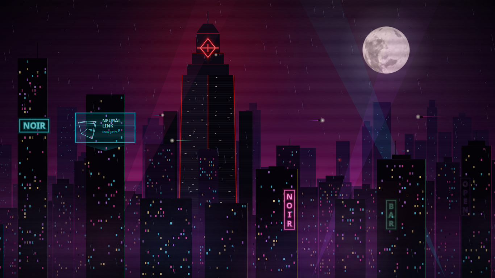
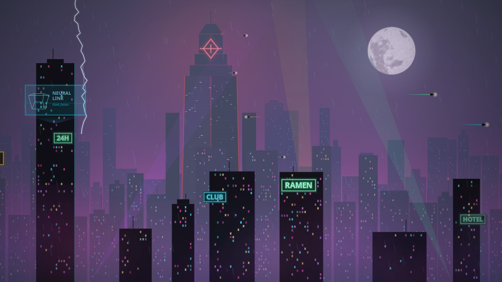
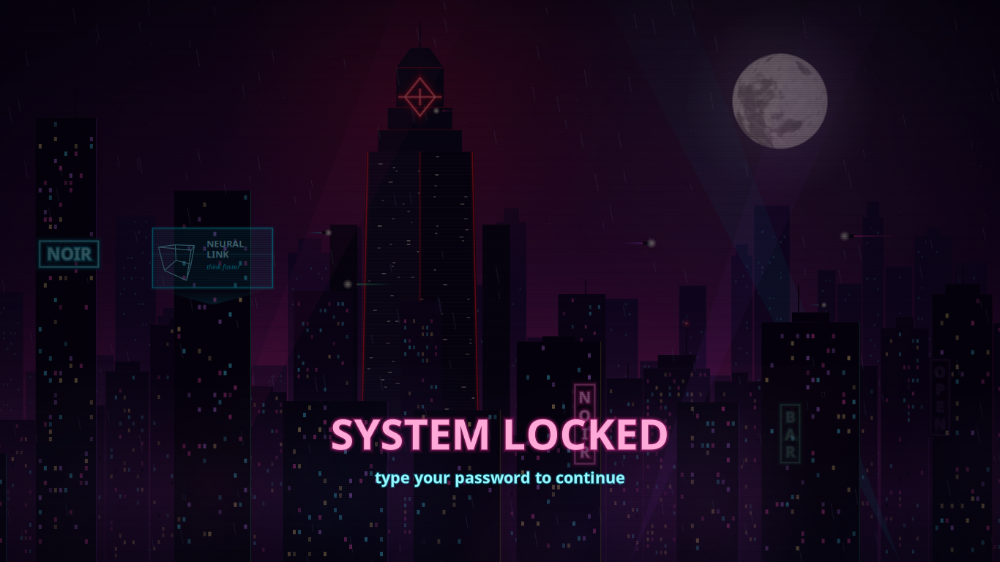

# cyberpunk-i3

An animated, procedurally generated cyberpunk city wallpaper for **i3 / X11**, plus a matching neon theme for i3, i3bar, rofi, dmenu, dunst, GNOME Terminal and the lock screen.



Everything is drawn live with cairo, so there are no videos or images to download, and every restart builds a new random skyline.

## What's in the city
- A dark corporate megatower with red edge lights, a stepped crown and a pulsing emblem
- A full moon textured as a sphere, with seas, craters and bright ray craters
- Three layers of buildings with flickering windows and blinking rooftop warning lights
- Neon signs, some steady, some pulsing and some flickering like they're broken
- A holographic billboard cycling through ads, with a rotating wireframe and glitches
- Flying cars with light trails, sweeping searchlights, rain and drifting fog
- Lightning every minute or so, plus CRT scanlines and the occasional screen glitch

| Lightning | Lock screen |
|---|---|
|  |  |

## Light on resources
- It runs as a click-through window that stays below all other windows
- It **pauses completely** when windows cover the screen (≈0% CPU)
- It drops to half the frame rate when you're on battery
- Each frame takes about 15 ms at 1366×768 at the default 24 fps

## Requirements
Python 3 with PyGObject (GTK 3) and pycairo. Ubuntu and Debian ship these by default (`python3-gi`, `python3-gi-cairo`, `python3-cairo`). The lock screen also needs `i3lock`, and auto-lock needs `xss-lock`.

## Install
```sh
git clone https://github.com/mario020mg/cyberpunk-i3
cd cyberpunk-i3
./install.sh
```
Then copy what you want from `theme/` into your configs:

| File | Goes into |
|---|---|
| `theme/i3-colors.conf` | `~/.config/i3/config` (colours, bar, autostart, lock binding) |
| `theme/i3status-colors.conf` | the `general {}` block of `~/.config/i3status/config` |
| `theme/rofi.rasi` | `~/.config/rofi/config.rasi` |
| `theme/dunstrc` | `~/.config/dunst/dunstrc` |
| `theme/gnome-terminal.sh` | run it once |

For dmenu, add `-nb '#0d0221' -nf '#e6dcff' -sb '#ff2a9e' -sf '#0d0221'`.

## Options
```
cyberpunk-wallpaper                 run as wallpaper
cyberpunk-wallpaper --fps 15        lower CPU use
cyberpunk-wallpaper --seed 42       always build the same city
cyberpunk-wallpaper --png out.png   render one frame and exit
```

## Palette
`#0d0221` night · `#ff2a9e` neon pink · `#00ebff` cyan · `#8a2be2` purple · `#ffd138` amber

## License
MIT
